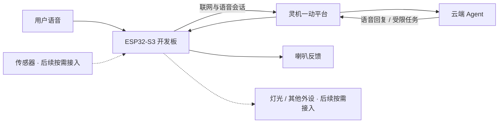

<div align="center">

# 灵机 · AI 硬件黑客松

**让 Agent 听见现实、理解任务，并给出可验证的反馈。**

从一段语音对话开始，走向一个真正可用的硬件原型。

[](https://github.com/fingercd/ljyd-ai-hardware-hackathon/actions/workflows/project-checks.yml)


[项目状态](#项目状态) · [系统架构](#系统架构) · [快速开始](#快速开始) · [开发路线](#开发路线) · [团队](#团队)

</div>

---

## 关于项目

这是一个基于 **灵机一动平台 × ESP32-S3** 的黑客松协作项目。我们希望把云端 Agent 的理解与对话能力，连接到真实设备的输入、状态和动作，而不是停留在网页里的聊天演示。

当前先完成最小闭环：**语音输入 → Agent 处理 → 语音回复 → 可验证的设备反馈**。具体产品场景由团队共同确定；传感器和执行器按场景逐项接入，不为了堆功能而堆硬件。

> **真实进度声明**：项目仍在基础环境与首次编译阶段。开发板尚未完成实物核验、烧录、配网或端到端测试；目前没有可展示的实物 Demo，也没有已实现的自定义硬件工作流。

## 项目状态

| 层面 | 当前情况 |
| :--- | :--- |
| 团队协作 | 公开仓库已建立；两位协作者邀请已发出 |
| 官方 SDK | 已获取，使用 submodule 固定版本，不把整套第三方源码复制进项目历史 |
| 开发环境 | 独立工具链与 Python 环境已安装；首次固件构建验证中 |
| 实物连接 | 待核对开发板版本、USB 接口、串口与供电 |
| 云端 Agent | 待确定产品身份、角色与实际关联方式 |
| 功能与演示 | 待实板最小链路验证后推进 |

详细结果和已知限制见 [开发状态](docs/STATUS.md)。状态会随着真实验证更新，不以计划替代完成记录。

## 系统架构

下图是**目标链路**，不是已经完成的功能清单。



- **平台端**：产品与设备管理、Agent 配置，以及实际开放的云端能力。
- **设备端**：音频、联网、状态上报和经过验证的外设逻辑。
- **开发端**：版本锁定、固件构建、日志排障与可恢复的交付记录。

平台可见入口不代表相应 API 已验证；传感器和动作仅在完成实板测试后才标记为可用。

## 快速开始

### 1 · 获取项目

建议先使用**无空格的英文路径**。当前提供 Windows 开发入口。

```powershell
git clone --recurse-submodules https://github.com/fingercd/ljyd-ai-hardware-hackathon.git
cd ljyd-ai-hardware-hackathon
```

已有 checkout 缺少 SDK 时：

```powershell
git submodule update --init --recursive
```

### 2 · 准备并构建

需要 Git 与可通过 `py -3.11` 找到的 Python 3.11。脚本使用厂商仓库内置的 **ESP-IDF 5.4.1**，不要求另装一套 latest IDF。

```powershell
.\scripts\setup.cmd   # 首次安装，依赖下载需要网络
.\scripts\build.cmd   # 仅构建，不烧录、不擦除、不打开串口
.\scripts\ports.cmd   # 只枚举端口，不打开设备
```

工具链与 Python 依赖放在当前工作区 `.espressif/`，不往科研 Conda 环境安装。包下载会使用本机已有 pip 索引设置及脚本指定的 Espressif 工具镜像；首次安装会下载并执行这些依赖。

**环境说明：** Windows 中文路径可能影响原生构建工具。本机使用指向原目录的英文目录联接，并禁用了已触发路径异常的 ccache。其他机器不要照抄本机绝对路径；参见 [构建说明](docs/build.md)。首次构建及入口的验证范围见状态页。

### 3 · 连接实物前

先阅读 [接板与首次联调](docs/hardware-bringup.md)，确认板型、接口和电气条件。**构建成功不代表适合直接刷入你手上的板子。**

本仓库没有自动刷写入口，避免在不明确目标 COM、原固件和产品身份时误操作。公开仓库也不包含产品密钥、Wi-Fi 密码或设备 Flash 备份。

## 开发路线

- [x] 获取并固定厂商 SDK 基线
- [x] 准备独立工具链与本机开发入口
- [x] 建立 Git 协作约定与公开内容检查
- [ ] 完成首次固件构建验收
- [ ] 核对实物并完成最小语音联网链路
- [ ] 确定一个明确用户场景，完成一条真实 Agent 任务
- [ ] 按需增加一个外设闭环，验证失败与重启恢复
- [ ] 录制真实 Demo，整理可复现的演示与交付说明

## 仓库导航

```text
.
├── ljyd-sdk/                 # 厂商 SDK submodule，固定 commit
├── scripts/                  # 环境、仅构建、端口枚举与公开内容检查
├── docs/
│   ├── STATUS.md             # 真实进度、验证边界与下一步
│   ├── build.md              # 环境与构建说明
│   ├── hardware-bringup.md    # 首次接板检查表
│   └── development-guidelines.md
├── AGENTS.md                 # AI 编程助手的项目约定
├── CONTRIBUTING.md           # 团队 Git 协作方式
└── .github/                  # 轻量检查与 PR 模板
```

本机 `.espressif/`、`.local/`、原始日志、资料汇编和备份均被忽略，不会随源码公开。

## 团队

| 成员 | GitHub | 协作状态 |
| :--- | :--- | :--- |
| fingercd | [@fingercd](https://github.com/fingercd) | 维护者 |
| Yangyuheng1021 | [@Yangyuheng1021](https://github.com/Yangyuheng1021) | 已邀请，待接受 |
| Yemi250 | [@Yemi250](https://github.com/Yemi250) | 已邀请，待接受 |

分工随实际任务在 Issue / PR 中明确，不预先替成员分配角色。开始贡献前请阅读 [CONTRIBUTING.md](CONTRIBUTING.md)。

## 来源与许可边界

基础硬件与 SDK 来自 [灵机一动](https://www.ljyd.cn/) 和 [官方开发者仓库](https://gitee.com/xj-open/ljyd_xjwb03_agent_public_developer)。第三方代码、模型及组件保留各自版权与许可，仓库公开不等于统一更改它们的授权。

赛事手册、用户提供的完整 Word/PDF 和第三方实物图片保留在本机，未确认公开转载许可前不随本仓库分发。本项目新增内容暂未声明统一开源许可证；使用或再分发时请先确认适用许可。

---

<div align="center">
<sub>先让一件小事在真实设备上可靠发生，再把它做成值得演示的作品。</sub>
</div>
