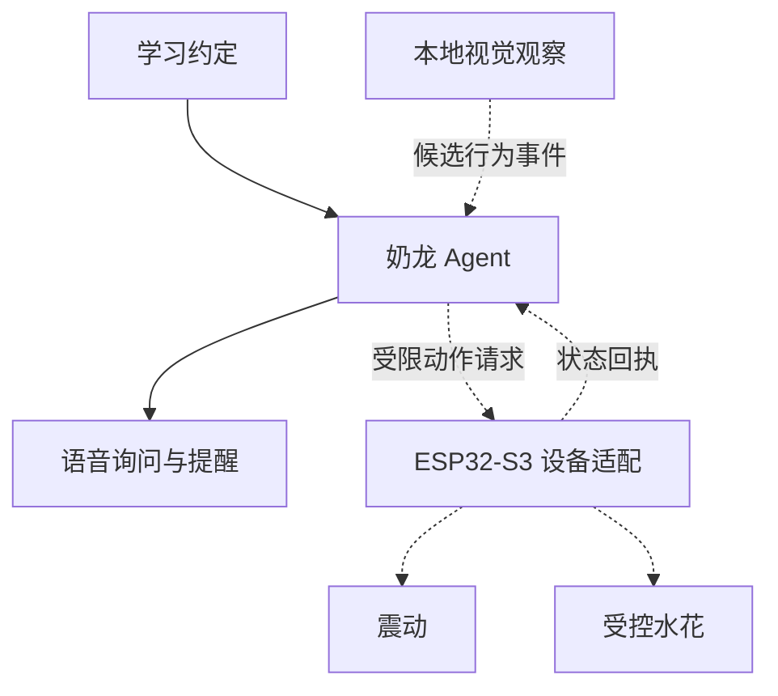

<div align="center">

# 奶龙盯盯 · Study Dino

### 长得像来陪读的，其实是来抓摸鱼的。

**目标体验：语音立约 · 行为观察 · 震动提醒 · 水花互动**

<sub>原型设计中 · 实物闭环待验证</sub>

把「我真的要开始学习了」，交给一只有点脾气的奶龙。

[](https://github.com/fingercd/ljyd-ai-hardware-hackathon/actions/workflows/project-checks.yml)


[作品设想](#奶龙今天为什么生气) · [互动闭环](#从一句约定到一点动静) · [怎么开始](#先让奶龙会说话) · [真实进度](#第一只奶龙还在上岗准备) · [团队](#团队)

</div>

---

> **当前是作品设计与工程准备阶段。** 下文的行为观察、震动和喷水是目标交互，尚未完成实板闭环验收。没有识别准确率、学习效果或实物 Demo 的已验证声明。

## 奶龙今天为什么生气？

打开书，只想查一个单词，结果手机越划越顺手。

我们想给这种时刻请一个小搭子：**把奶龙放上书桌，本来是想有人陪读，结果给自己请了个监考员。**

「奶龙盯盯」面向自愿接受监督的独自学习者。它拟通过约定的可见行为线索发现可能偏离学习计划的时刻，用语音先问清楚，再按用户选择的模式给出震动与受控喷水反馈——让提醒从屏幕里的一个通知，变成桌边真正有存在感的一次互动。

它可以有点欠，但要讲理：**休息不是摸鱼，低头不等于分心，摄像头也不能读懂你的注意力。**

## 从一句约定，到一点动静

以下是**预期体验脚本**，不是实测记录。

| 时刻 | 你在做什么 | 奶龙的目标反应 |
| :--- | :--- | :--- |
| **立约** | 「奶龙，陪我学二十分钟。」 | 明确学习区、休息规则和提醒模式；喷水单独选择开启 |
| **观察** | 出现约定的持续离场等可见线索 | 标记候选事件，不直接下结论说你「不认真」 |
| **查岗** | 奶龙询问：「刚才离开学习区，是在拿书，还是想休息一下？」 | 结合当前约定与用户回答，允许解释、休息和暂停 |
| **动真格** | 触发条件成立，且当前模式已获同意 | 一次有边界的震动；可选模式在独立接水区产生少量水花 |
| **回来** | 你回到任务或要求停止 | 给出设备状态；不循环轰炸，不把「已发送」说成「已执行」 |

**我们的记忆点：你负责学习，奶龙负责让摸鱼有点动静。**

喷水不是朝人脸发射的惩罚。设计目标是低量、低压、固定方向的桌面互动，水路与电子隔离，有硬停用，并由用户主动同意。详见 [产品与交互方案](docs/product.md)。

## 一个有角色的 Agent，一条真实的反馈链

下面是**目标架构**；虚线表示待接入的个性化部分。



- **角色有性格**：用奶龙的反差感让人愿意互动，而不是把通用助手换个名字。
- **提醒有理由**：对照用户自己的学习约定，区分可能偏离、合理休息和不可判断。
- **反馈有实体**：语音、震动与水花构成可感知的桌面体验；完成与否要看设备结果。
- **监督有边界**：本人自愿、可暂停、可解释；视觉本地处理和默认不上传原始视频是待实现目标，不宣传已经「完全离线」。

前期可用电脑摄像头做单人学习区在场／离场的**交互预演**，但这不能替代指定SPI摄像头的坐姿应用；另需区分至少三类使用情境，不强行等同三种坐姿。最终采集链路、推理部署和真实分类仍需核对；不承诺开发板已能识别，也不把离场直接等同于不认真学习。

## 让创意对上赛题

依据今日保存的赛题资料，最终目标是两条共用学习上下文的工作流，而非一个单独的喷水按钮：

| 目标工作流 | 触发与处理 | 预期反馈 |
| :--- | :--- | :--- |
| 学习状态查岗 | 真实摄像头／姿态事件→持续性和当前约定→询问、解释、提醒 | 语音＋已同意模式下的震动／受控水花 |
| 主动休息与复归 | 用户语音申请休息或暂停→共享会话状态→停止监督、确认复归 | 语音回应＋执行器停用／恢复状态回执 |

候选可见状态为「在座且符合约定姿态」「持续偏离约定姿态」「离座」；遮挡或无法判断另列未知状态，不当成摸鱼。它们是**分类设计，不是已验证的平台输出**。三类情境要求不等于必须实现上述三种坐姿标签。完整要求与待交付项见 [赛题对齐清单](docs/challenge-checklist.md)。

## 先让奶龙会说话

按用户转述的主办方推荐路线，优先验证交互，再接设备，最后个性化开发：

### 01 · 平台交互创建

进入 [灵机一动平台](https://platform.ljyd.cn/)，优先使用交互创建能力建立奶龙角色。具体入口名称与可用字段以当前账号界面为准。

角色草案已备好：[奶龙角色提示词](agent/study-dino.prompt.md)。它是待配置草案，不代表云端已创建或发布。

### 02 · 调试预览

先检查立约、可能分心、合理休息、误判、停止和设备失败时的回答。使用 [预览测试用例](agent/preview-cases.md)，测试事件明确标记为人工输入，不能冒充摄像头识别。

### 03 · 标准设备接入

核对板型、产品身份和实际入口，再接入开发板，完成联网、连续语音与重启恢复。参见 [接板与首次联调](docs/hardware-bringup.md)。标准链路未通前，不把故障归因到个性化业务。

### 04 · 个性化开发

逐项加入真实行为事件、震动与水路控制，分别验收后再合成闭环。Agent 提出动作，确定性规则检查模式、目标、参数和安全状态，设备执行并反馈；平台实际接口和设备适配方式还需验证。

SDK 与独立工具链已准备，作为定制与排障基础，不是第一次体验作品必须先完成的步骤。需要固件构建时，查看 [构建说明](docs/build.md)。

## 第一只奶龙，还在上岗准备

| 模块 | 实际状态 |
| :--- | :--- |
| 产品定位、角色与路演 | 已形成方案；是设计成果，不等于功能落地 |
| Git 与团队协作 | 公开仓库、贡献说明、CI 内容检查与本地规则测试已建立 |
| 会话与安全规则 | 本地确定性逻辑已实现，41项单元测试通过；不是云端/实物闭环 |
| SDK 与工具链 | 已安装；构建结果与限制见 [开发状态](docs/STATUS.md) |
| 平台交互创建／调试预览 | 独立Agent草案已保存；未配置插件/工作流、预览或产品设备绑定 |
| 标准设备接入 | 本机已确认COM3及25cb6e51基线启动/云连接；语音、Agent和外设待验证 |
| 真实视觉、震动、喷水 | 待开发与分别验收；暂无实物闭环 Demo |

没有真实 Demo 时，不用概念视频或按钮触发冒充 AI 识别。演示路径和降级标注见 [路演与 Demo 脚本](docs/demo.md)。

## 工程与协作

```text
agent/                角色草案与平台预览用例
ljyd-sdk/             厂商 SDK submodule，精确锁定版本
scripts/              环境、构建与公开内容检查
docs/                 产品方案、演示、状态与接板说明
AGENTS.md             AI 编程助手的开发约定
CONTRIBUTING.md       团队 Git、PR 和公开内容边界
```

新成员获取源码：

```powershell
git clone --recurse-submodules https://github.com/fingercd/ljyd-ai-hardware-hackathon.git
cd ljyd-ai-hardware-hackathon
```

无需硬件可先运行规则回放：

```powershell
py -3.11 -m unittest discover -s tests -v
py -3.11 -m study_dino examples/session-preview.jsonl
```

每行明确标记为本地模拟且未执行硬件。参数和输入格式见 [本地预览说明](docs/local-preview.md)，这不替代主办方推荐的平台调试预览。

Windows 的 SDK 入口为 `scripts/setup.cmd`、`scripts/build.cmd`、`scripts/ports.cmd`。构建与刷写分离，不在预览阶段自动操作实物。工具链、密钥、本机日志、完整资料与设备备份不入库。

### 开发板摄像头网页

已有相机诊断固件时，在项目目录运行：

```powershell
.\scripts\camera-web.cmd
```

启动时默认打开开发板串口并保持连接，自动打开本机网页，提供重新连接、PNG 拍照和低帧率无声录像。当前固件一帧一复位，不是实时视频；不要同时运行串口监视器。图像不上传。实板验证范围与限制见 [相机说明](docs/camera-first-capture.md)。

## 团队

| 成员 | GitHub | 协作状态 |
| :--- | :--- | :--- |
| fingercd | [@fingercd](https://github.com/fingercd) | 维护者 |
| Yangyuheng1021 | [@Yangyuheng1021](https://github.com/Yangyuheng1021) | 已加入，Write |
| Yemi250 | [@Yemi250](https://github.com/Yemi250) | 已邀请，待接受 |

任务分工在 Issue / PR 中明确。开始贡献前请看 [CONTRIBUTING.md](CONTRIBUTING.md)。

## 来源与边界

硬件开发基础来自 [灵机一动](https://www.ljyd.cn/) 与 [官方 SDK](https://gitee.com/xj-open/ljyd_xjwb03_agent_public_developer)。第三方代码、模型和素材保留各自许可；项目新增内容尚未声明统一开源许可证。

本项目是**非官方奶龙创意原型**，不代表 IP 权利方的官方产品、联名或背书，仓库不分发未经确认可使用的角色素材。赛事全文、用户完整 Word/PDF 和账户信息保留在本机。

[开发规范依据](docs/development-guidelines.md) · [产品叙事参考与取舍](docs/product.md#参考与取舍)

---

<div align="center">
<sub>陪你学，也提醒你回来。奶龙有点脾气，监督始终由你决定。</sub>
</div>
